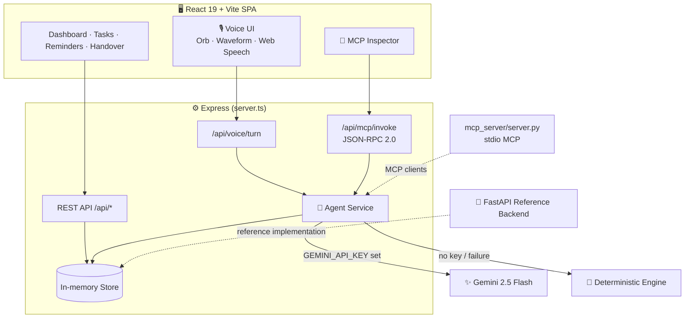

<div align="center">

<br/>

# 🎙️ EchoCare AI

### Proactive, Voice-First Agentic Home Care Coordinator

**Care tasks · Medication reminders · Caregiver handovers · MCP tools · Safety-first guardrails**

<br/>

<a href="https://echo-care-ai.vercel.app/">
  
</a>

<br/><br/>


<br/>

**[🌐 Live Demo](https://echo-care-ai.vercel.app/)** &nbsp;•&nbsp;
**[✨ Features](#-features)** &nbsp;•&nbsp;
**[🏗️ Architecture](#️-architecture)** &nbsp;•&nbsp;
**[🚀 Getting Started](#-getting-started)** &nbsp;•&nbsp;
**[📡 API](#-api-reference)** &nbsp;•&nbsp;
**[🗺️ Roadmap](#️-roadmap)**

<br/>

> Built for the **Amazon Developer Hackathon 2026**.
> An assistant that doesn't just answer questions. It checks the day's care plan, reminds, hands over and stays inside clear safety limits.

<br/>

</div>

---

<div align="center">

## 📖 Overview

</div>

<div align="center">

**EchoCare AI** helps families and caregivers coordinate daily home care for a loved one.
Talk to it or tap through the dashboard to manage **care tasks**, **medication reminders** and **shift handovers**,
all backed by a tool-using AI agent that is also exposed as an **MCP server**.

</div>

<br/>

<div align="center">

| 🗣️ Voice-first | 🤖 Agentic | 🛡️ Safety-first | 🔌 Interoperable |
|:---:|:---:|:---:|:---:|
| Animated AI orb, live waveform, Web Speech API | Tool-calling agent that acts on real care records | Confirmation for consequential actions; no medical advice | MCP over HTTP (JSON-RPC 2.0) and stdio |

</div>

---

<div align="center">

## ✨ Features

</div>

<div align="center">

| | Feature | What it does |
|:---:|:---|:---|
| 🎙️ | **Voice assistant** | Wake-word style interaction, animated orb, Web Audio waveform, one-tap voice bar and a command cheat-sheet |
| ✅ | **Care task management** | Create, complete, cancel and delete tasks; daily care goals and wellness check on the dashboard |
| ⏰ | **Smart reminders** | Create, list, toggle, update and cancel medication and care reminders |
| 🤝 | **Caregiver handover** | Generates shift handover reports compiled **only from stored records**, never invented |
| 🕘 | **Activity history** | A searchable audit trail of what the agent and caregivers did |
| 🌍 | **Multilingual UI** | Language packs for English, Tamil, Hindi, Malayalam, Telugu and Kannada |
| 🔌 | **MCP server + Inspector** | Browse and call every agent tool from an in-app MCP Inspector page |
| 🧠 | **Dual agent engine** | Gemini 2.5 Flash tool-use when a key is set, with a deterministic fallback when it isn't |
| 🌓 | **Light / dark theme** | Theme context with polished, responsive layouts |

</div>

<br/>

<div align="center">

### 🛡️ Safety Design

</div>

<div align="center">

| Principle | How it shows up |
|:---|:---|
| **Confirm before consequences** | Actions such as cancelling a task ask *"Are you sure?"* first |
| **Records, not guesses** | Summaries and handovers are built from stored data only |
| **Medical boundary** | The assistant won't change medication doses; it defers to the care recipient's physician |
| **Not an emergency service** | For emergencies, contact local emergency services |

</div>

---

<div align="center">

## 🏗️ Architecture

</div>



<div align="center">

**Layers:** UI → Express API → Agent service → Store, with an MCP surface over the same tools.

</div>

---

<div align="center">

## 🧰 Tech Stack

</div>

<div align="center">

| Layer | Technology |
|:---:|:---|
| **Frontend** | React 19 · TypeScript · Vite 8 · Tailwind CSS 4 · Recharts · Lucide · Framer Motion |
| **Server** | Node.js · Express · `tsx` (serves the API and the built SPA on port 3000) |
| **AI** | Google Gemini 2.5 Flash (`@google/genai`) with a deterministic fallback engine |
| **Protocol** | Model Context Protocol `2024-11-05` · JSON-RPC 2.0 · stdio and HTTP |
| **Reference backend** | Python · FastAPI · Pydantic · SQLAlchemy · pytest |
| **Packaging** | Docker · docker-compose (`echocare-app`, `echocare-mcp`) |
| **Hosting** | Vercel |

</div>

---

<div align="center">

## 🚀 Getting Started

</div>

<div align="center">

**Prerequisites:** Node.js 18+ &nbsp;•&nbsp; Python 3.10+ (optional, for the reference backend)

</div>

### 1 · Run the app

```bash
git clone https://github.com/sathi2305/EchoCare-AI.git
cd EchoCare-AI

npm install
cp .env.example .env     # optional: add GEMINI_API_KEY for the Gemini engine
npm run dev              # → http://localhost:3000
```

> No API key? The agent falls back to its deterministic engine, so the app works out of the box.

### 2 · Environment variables

| Variable | Default | Purpose |
|:---|:---|:---|
| `GEMINI_API_KEY` | *(empty)* | Enables Gemini 2.5 Flash tool-use |
| `PORT` | `3000` | Server port |
| `NODE_ENV` | `development` | Runtime mode |
| `ECHOCARE_INFERENCE_ENGINE` | `hybrid` | `hybrid` · `gemini_teacher` · `deterministic` · `lora` |
| `ECHOCARE_WAKE_WORD` | `EchoCare` | Voice wake word |
| `ECHOCARE_DEFAULT_LANG` | `en-US` | Default speech language |
| `ECHOCARE_AUTO_LISTEN` | `true` | Auto-listen after a reply |

### 3 · Reference backend (optional)

```bash
cd backend
pip install -r requirements.txt
uvicorn app.main:app --reload --port 8000
pytest tests/test_api.py -v
```

### 4 · Run with Docker

```bash
docker-compose up --build
```

### 5 · Use it as an MCP server

```bash
python mcp_server/server.py          # stdio transport
```

```bash
curl -X POST http://localhost:3000/api/mcp/invoke \
  -H "Content-Type: application/json" \
  -d '{"jsonrpc":"2.0","id":1,"method":"tools/list"}'
```

---

<div align="center">

## 📡 API Reference

</div>

<div align="center">

| Area | Endpoints |
|:---|:---|
| **Health** | `GET /api/health` |
| **Dashboard** | `GET /api/dashboard/summary` |
| **Tasks** | `GET` `POST /api/tasks` · `PATCH /api/tasks/:id/complete` · `PATCH /api/tasks/:id/cancel` · `DELETE /api/tasks/:id` |
| **Reminders** | `GET` `POST /api/reminders` · `PATCH /api/reminders/:id/toggle` · `DELETE /api/reminders/:id` |
| **Handovers** | `GET` `POST /api/handovers` · `POST /api/handovers/generate` |
| **Activity** | `GET` `POST /api/activities` |
| **Profile / Settings** | `GET` `PUT /api/profile` · `GET` `PUT /api/settings` |
| **Agent** | `POST /api/agent/chat` · `POST /api/agent/execute-tool` |
| **Voice** | `POST /api/voice/turn` · `GET` `DELETE /api/voice/session/:id` |
| **MCP** | `GET /api/mcp/tools` · `POST /api/mcp/invoke` |
| **Demo** | `POST /api/demo/reset` |

</div>

<div align="center">

### 🔌 Agent / MCP Tools

`get_daily_summary` · `list_care_tasks` · `create_care_task` · `complete_care_task` · `cancel_care_task` ·
`create_reminder` · `list_reminders` · `update_reminder` · `cancel_reminder` · `generate_handover` · `get_activity_history`

</div>

---

<div align="center">

## 📁 Project Structure

</div>

```text
EchoCare-AI/
├── server.ts                 # Express API + static SPA host
├── src/
│   ├── App.tsx
│   ├── server/               # agent, store, voice service
│   ├── services/             # API client, conversation storage
│   ├── utils/                # audio, voice client, i18n
│   ├── context/              # theme
│   └── components/
│       ├── common/           # AiOrb
│       ├── dashboard/        # care goals, wellness check
│       ├── layout/           # Header, Sidebar
│       ├── pages/            # Overview, CareTasks, Reminders, Handover,
│       │                     # AiAssistant, McpInspector, Settings, ...
│       └── voice/            # voice modal, bar, waveform, cheat sheet
├── backend/                  # FastAPI reference backend + tests
├── mcp_server/               # stdio MCP server
├── training/                 # LoRA dataset, configs, scripts (experimental)
├── models/                   # adapter manifest/config (no weights)
├── docs/                     # api, architecture, MCP integration
├── tests/
├── Dockerfile.mcp
└── docker-compose.yml
```

---

<div align="center">

## 🌐 Deployment

</div>

<div align="center">

**Live now:** [**echo-care-ai.vercel.app**](https://echo-care-ai.vercel.app/)

</div>

- **Vercel** hosts the public demo.
- **Docker / docker-compose** runs the app and the MCP server together.
- Set `GEMINI_API_KEY` in your host's environment settings to enable the Gemini engine; otherwise the deterministic engine is used.

---

<div align="center">

## 🧪 Testing

</div>

```bash
cd backend && pytest tests/test_api.py -v     # reference backend
python -m pytest tests/ -q                    # dataset, safety, tool-call and model-output checks
```

<div align="center">

Verified when this README was written: **4 backend tests** and **15 dataset / safety / tool-call tests** passing.

</div>

---

<div align="center">

## 🔬 About the LoRA Training Folder

</div>

<div align="center">

The repo includes an **experimental** fine-tuning scaffold for `Qwen/Qwen2.5-0.5B-Instruct` (LoRA r=16, α=32, 33-record multilingual dataset, config and scripts).

</div>

> **Please read:** this part is a scaffold, not a shipped model.
> No adapter weights (`adapter_model.safetensors`) are included. When ML packages are missing, `train_sft.py` writes **placeholder** loss and config files, and `evaluate_model.py` scores **simulated** responses. The loss curve and the benchmark figures in `training/evaluations/` are therefore **not measured results**.
> The live app runs on **Gemini 2.5 Flash** or the **deterministic engine**. Run `train_sft.py` in an environment with `torch`, `transformers`, `peft`, `trl` and `datasets` to produce a real adapter.

---

<div align="center">

## 🗺️ Roadmap

</div>

<div align="center">

| Status | Item |
|:---:|:---|
| ✅ | Voice UI, tasks, reminders, handovers, activity history |
| ✅ | Tool-using agent with Gemini and deterministic engines |
| ✅ | MCP server (HTTP + stdio) with in-app Inspector |
| 🔜 | Persistent database in place of the in-memory store |
| 🔜 | Authentication and per-caregiver permissions |
| 🔜 | Real LoRA training run and genuine held-out evaluation |
| 🔜 | Push notifications for due reminders |
| 💡 | Wearable and device integrations |

</div>

---

<div align="center">

## 🤝 Contributing

</div>

<div align="center">

Contributions are welcome.

**Fork** → **Branch** (`feature/your-idea`) → **Commit** → **Push** → **Open a Pull Request**

</div>

---

<div align="center">

## 📄 License

Released under the **Apache License 2.0**.

<sub>Add a `LICENSE` file to the repository root so the license is machine-detectable on GitHub.</sub>

</div>

---

<div align="center">

## 👨‍💻 Author

**Sathiyamoorthi** · [@sathi2305](https://github.com/sathi2305)

<br/>

> ⚠️ **Disclaimer:** EchoCare AI is a coordination aid, not a medical device or emergency service.
> It does not diagnose, prescribe or change medication. In an emergency, call your local emergency number.

<br/>

<a href="https://echo-care-ai.vercel.app/">
  
</a>

<br/><br/>

**⭐ If EchoCare AI helps you, please star the repo! ⭐**

<sub>Made with ❤️ for the Amazon Developer Hackathon 2026</sub>

</div>
